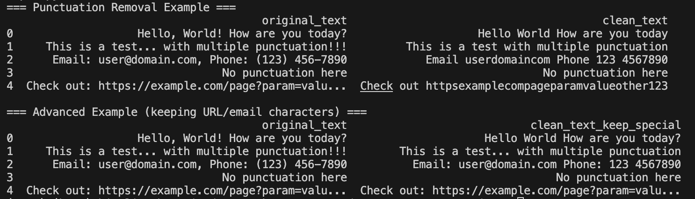

# Punctuation Removal

## What is Punctuation Removal?
Punctuation removal is the process of eliminating punctuation marks from text data. Punctuation characters like `.,!?()[]{}:;"'` often don't carry semantic meaning and can add noise to text analysis.

## Why Remove Punctuation?
- Reduces noise in text data
- Simplifies tokenization
- Improves model performance
- Standardizes text format



## Common Punctuation Characters
```python
import string
print(string.punctuation)
# Output: !"#$%&'()*+,-./:;<=>?@[\]^_`{|}~
```

## Implementation
See `implementation.py` for the complete code.

## Example Usage
See `example.py` for practical examples.
