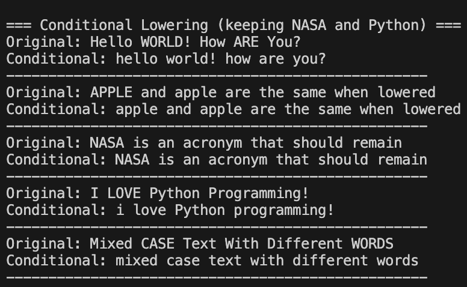

# Text Lowering

## What is Text Lowering?
Text lowering (or case normalization) is the process of converting all text to lowercase. This ensures that the same word in different cases is treated as identical.

## Why Lower Text?
- Standardizes text format
- Treats "Apple", "apple", and "APPLE" as the same word
- Reduces vocabulary size
- Improves model consistency

## When NOT to Lower Text
- When analyzing sentiment (uppercase may indicate shouting/emphasis)
- When dealing with proper nouns that need distinction
- When case carries important information
- In some named entity recognition tasks

## Implementation
See `implementation.py` for the complete code.

## Example Usage
See `example.py` for practical examples.
