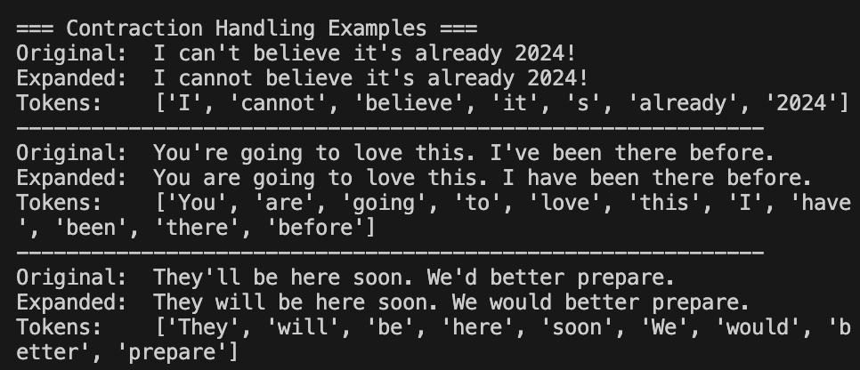

# Tokenization

## What is Tokenization?
Tokenization is the process of breaking down text into smaller units called tokens. These tokens can be words, sentences, or subword units depending on the requirements.

## Types of Tokenization
- **Word Tokenization**: Splits text into individual words
- **Sentence Tokenization**: Splits text into sentences
- **Subword Tokenization**: Splits words into meaningful subunits

## Why Tokenize?
- Converts text into machine-readable format
- Enables word-level analysis
- Required for most NLP tasks
- Forms the basis for feature extraction

## Common Challenges
- Handling contractions (don't → do + n't)
- Dealing with punctuation
- Managing special characters and emojis
- Processing different languages

## Implementation
See `implementation.py` for the complete code.

## Example Usage
See `example.py` for practical examples.
