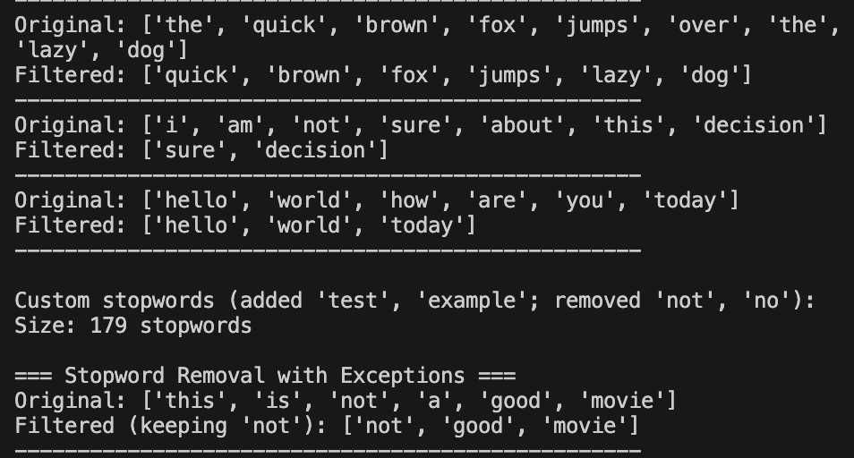

# Stopword Removal

## What are Stopwords?
Stopwords are common words that appear frequently in text but carry little semantic meaning. Examples include "the", "is", "at", "which", "and", etc.

## Why Remove Stopwords?
- Reduces noise in text data
- Decreases vocabulary size
- Improves computational efficiency
- Focuses analysis on meaningful words
- Enhances model performance for many tasks

## When NOT to Remove Stopwords
- In sentiment analysis (words like "not", "no" are important)
- In question answering systems
- When context is important
- In some phrase-based searches

## Common English Stopwords
- Articles: the, a, an
- Prepositions: in, on, at, by, for
- Conjunctions: and, but, or
- Pronouns: I, you, he, she, it
- Common verbs: is, am, are, was, were

## Implementation
See `implementation.py` for the complete code.

## Example Usage
See `example.py` for practical examples.
