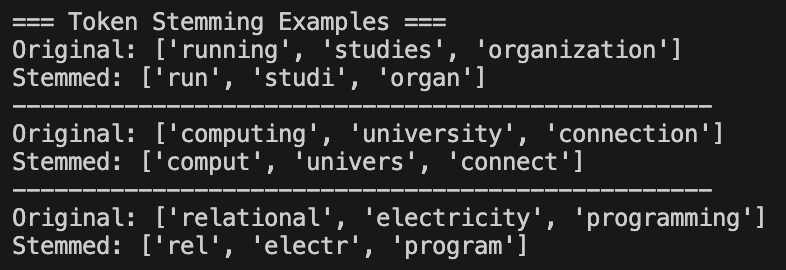

# Stemming

## What is Stemming?
Stemming is the process of reducing words to their root or base form by removing suffixes. It's a crude heuristic process that chops off word endings.

## Common Stemming Algorithms
- **Porter Stemmer**: Most common, gentle stemming
- **Snowball Stemmer**: Improved version of Porter
- **Lancaster Stemmer**: Aggressive stemming
- **Regexp Stemmer**: Uses regular expressions

## Examples of Stemming
| Original Word | Stemmed Word |
|---------------|-------------|
| running | run |
| studies | studi |
| organization | organ |
| computing | comput |
| university | univers |

## Advantages
- Reduces vocabulary size
- Groups related words together
- Fast computation
- Simple implementation

## Disadvantages
- May produce non-dictionary words
- Can lose word meaning
- Not context-aware
- Over-stemming or under-stemming issues

## When to Use Stemming
- Search engines
- Text classification
- Information retrieval
- When speed is important

## Implementation
See `implementation.py` for the complete code.

## Example Usage
See `example.py` for practical examples.
