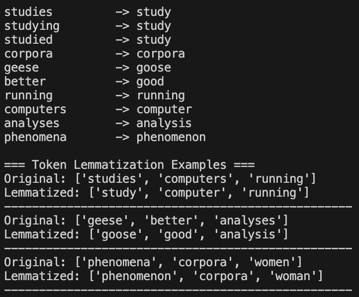

# Lemmatization

## What is Lemmatization?
Lemmatization is the process of reducing words to their dictionary form (lemma) while preserving the meaning. Unlike stemming, lemmatization uses vocabulary and morphological analysis.

## Lemmatization vs Stemming

| Aspect | Stemming | Lemmatization |
|--------|----------|---------------|
| **Output** | May not be real words | Always real words |
| **Speed** | Fast | Slower |
| **Accuracy** | Less accurate | More accurate |
| **Dictionary** | Not required | Required |
| **Context** | Not considered | Considered |

## Examples of Lemmatization

| Original Word | Stemmed | Lemmatized |
|---------------|---------|------------|
| studies | studi | study |
| better | better | good |
| corpora | corpora | corpus |
| geese | gees | goose |
| running | run | run |

## Advantages
- Produces real dictionary words
- Preserves word meaning
- More accurate than stemming
- Better for language understanding tasks

## Disadvantages
- Slower than stemming
- Requires more computational resources
- Needs part-of-speech information for best results
- More complex implementation

## When to Use Lemmatization
- Chatbots and conversational AI
- Language translation
- Sentiment analysis
- Text understanding tasks
- When accuracy is more important than speed

## Implementation
See `implementation.py` for the complete code.

## Example Usage
See `example.py` for practical examples.
